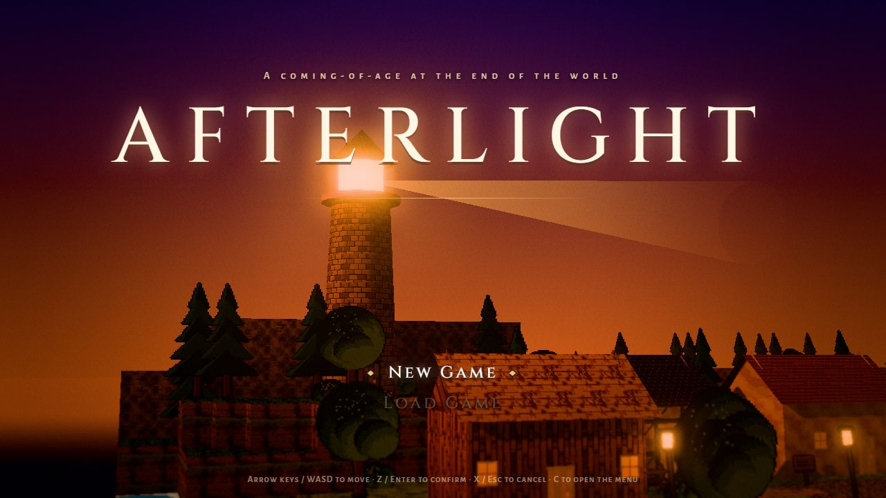
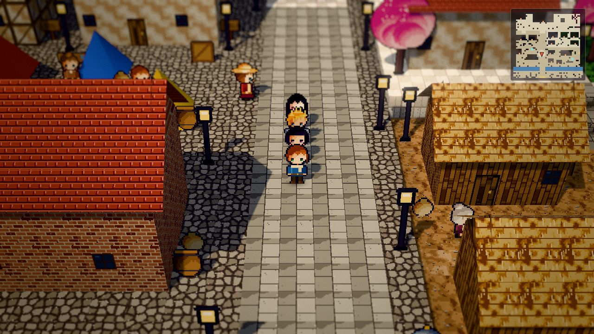
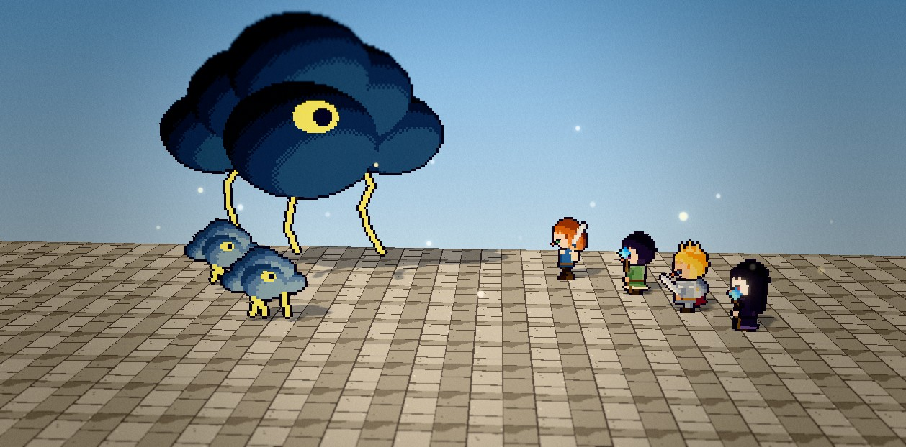
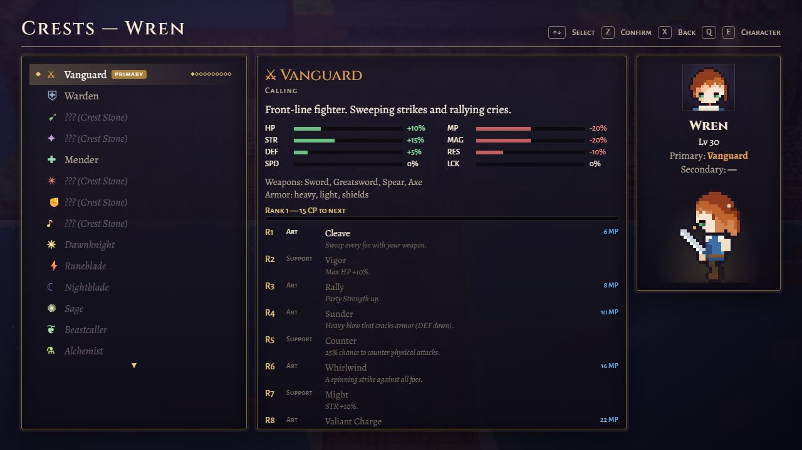
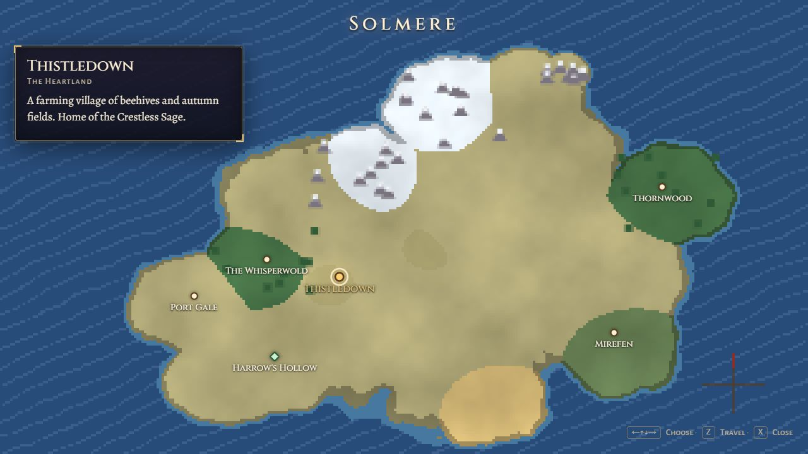

<div align="center">



# Afterlight

*The world ended on the day I came of age. This is what we built after.*

A 2D-HD JRPG built with three.js — pixel-art characters in lit, depth-of-field
dioramas — about a girl who causes the end of the world at sixteen, and grows up anyway.

**[▶ Play in your browser](https://friendlyuser.github.io/afterlight/)** · [Run it locally](#run-it-locally) · [Controls](#controls) · [Features](#features) · [Build & deploy](#build--deploy)

</div>

---

## Screenshots

<table>
  <tr>
    <td width="50%"><br><sub><b>Aurenne</b> — the party walks the city as a caravan.</sub></td>
    <td width="50%"><br><sub><b>The Thunderhead</b> — telegraphed attacks you can Guard or Break.</sub></td>
  </tr>
  <tr>
    <td width="50%"><br><sub><b>Crests</b> — 24 classes, 10 ranks each, primary + secondary.</sub></td>
    <td width="50%"><br><sub><b>Solmere</b> — fast travel across the world (before it breaks).</sub></td>
  </tr>
</table>

## Run it locally

No install and no build step: every sprite, texture and note of music is generated at
runtime (only the fonts are files). The game just needs to be served over HTTP:

```bash
python3 -m http.server 8765
```

Then open **<http://localhost:8765/>** in a modern browser with WebGL2 (Chrome, Edge,
Firefox or Safari). Saves (6 slots + an autosave) are kept in the browser, separately
for each site address. To back one up or move it to another computer or to the hosted
version, press <kbd>F</kbd> on a slot in the Save / Load screen to export it to a file
or import one.

## Controls

| Action | Keyboard | Gamepad |
|---|---|---|
| Move | <kbd>↑</kbd> <kbd>↓</kbd> <kbd>←</kbd> <kbd>→</kbd> or <kbd>W</kbd> <kbd>A</kbd> <kbd>S</kbd> <kbd>D</kbd> | D-pad / left stick |
| Run (hold) | <kbd>Shift</kbd> | <kbd>X</kbd> |
| Confirm · talk · examine | <kbd>Z</kbd> <kbd>Enter</kbd> <kbd>Space</kbd> | <kbd>A</kbd> |
| Cancel · back | <kbd>X</kbd> <kbd>Backspace</kbd> <kbd>Esc</kbd> | <kbd>B</kbd> |
| Open the menu | <kbd>C</kbd> <kbd>Tab</kbd> <kbd>Esc</kbd> | <kbd>Y</kbd> / <kbd>Start</kbd> |
| Switch leader (field) · Surge (battle) | <kbd>Q</kbd> / <kbd>E</kbd> | <kbd>LB</kbd> / <kbd>RB</kbd> |
| Auto-battle (battle) · Optimize (Equipment) · Export / Import (save slots) | <kbd>F</kbd> | <kbd>Back</kbd> |
| Fast Mode on / off (2–4×, set in Settings) | <kbd>T</kbd> | Left-stick click |

These are the default keys: remap any of them in **Settings → Controls** (up to three
keys per action; <kbd>Esc</kbd> always cancels and opens the menu). Your bindings are
saved with your game and travel with exported save files.

Settings also include text size and speed, encounter rate, difficulty (Story / Normal /
Hard), battle speed, Fast Mode speed, the minimap, the Quest Guide, and reduced flashes
& screen shake.

## Features

**Story** — 14 chapters across three acts (~74k words of scenes), two endings, and a
post-game descent through the 30-floor Gloam Abyss.

**Battle** — a turn-order timeline, Poise & Break, and the shared Afterglow gauge for
Surge and duo/trio Link Arts. Bosses telegraph their big attacks: Guard against them,
or Break the boss while it winds up to interrupt them. Swap party members mid-fight,
or hand it to auto-battle — and turn on Fast Mode to fly through fights and cutscenes.

**Class customization** — 24 Crests (8 callings, 10 braided, 6 legendary) × 10 ranks,
a primary and a secondary Crest per character, Supports on a point budget, and 300+ Arts.

**Exploration** — 145 hand-laid maps, a party that follows you, a Quest Guide that
marks where to go next (in the field, on the minimap and on the world map), doors that
swing open as you walk in, a minimap, a world map with fast travel, fishing, per-town side quests, the Hunters' Lodge bounty board
(10 marks + 2 hidden hunts), four optional dungeons, and New Game+.

**Presentation** — three.js 2D-HD rendering (bloom, tilt-shift depth of field, color
grading) with procedural pixel art for characters, monsters, tiles and props, and a
WebAudio soundtrack of 29 songs.

## Build & deploy

The game runs as-is, but for a release Vite bundles and minifies it into `dist/`:
an HTML file, a stylesheet, fonts, and ~25 JS chunks (the engine, three.js, one per
chapter) — about 3 MB, under 1 MB gzipped. All paths are relative, so `dist/` works on
any static host (GitHub Pages, itch.io, Netlify…).

```bash
npm install       # once — Vite is the only dependency
npm run build     # bundle into dist/
npm run preview   # serve dist/ on http://localhost:8767/
npm run dev       # optional: Vite dev server on http://localhost:8766/
```

**GitHub Pages:** [`.github/workflows/pages.yml`](.github/workflows/pages.yml) runs
`npm ci` → `npm run build` → deploys `dist/` on every push to `main` (or manually from
the Actions tab). One-time setup: repository **Settings → Pages → Source: GitHub
Actions**. The game is then served at `https://<user>.github.io/<repo>/`.

<details>
<summary><b>Building from WSL with Windows Node</b></summary>

Use `tools/npm.sh install`, `tools/npm.sh run build`, etc. It runs the Windows npm against
the WSL folder and makes Vite poll for file changes, since native watching doesn't work
across that share. Windows npm can't delete a `node_modules/` on the share, so remove
that folder from WSL before `npm ci`.
</details>

## Development

<details>
<summary><b>Debug shortcuts</b></summary>

Add these to the URL to jump straight into the game:

| Parameter | Effect |
|---|---|
| `?map=<id>&x=&y=` | Start on a map at a tile |
| `&party=ilse,bram&lv=20` | Party members and level |
| `&flags=a,b` | Set story flags |
| `&battle=<troop>&bg=<bg>` | Start a battle |
| `&menu=crests\|world\|settings\|shop:<id>` | Open a menu |
| `&debug` | FPS, draw calls and triangles overlay |
</details>

<details>
<summary><b>Tests and tools</b> (headless Chrome)</summary>

| Command | What it does |
|---|---|
| `tools/test.sh validate 40000` | Cross-reference checks for all content |
| `SIM=240 tools/test.sh <test> 2400000` | One story smoke test from `tests/` |
| `SIM=240 tools/test_all.sh [regex]` | The whole suite, one test at a time |
| `tools/test.sh balance 1500000` | Simulate every enemy troop with an even-level party |
| `tools/test.sh crest_balance 900000` | Check every Crest is viable |
| `EXTRA='troop=<id>' tools/test.sh fightlog 100000` | One fight, turn by turn |
| `tools/shot.sh "<url>" out.png 9000` | Screenshot (page + UI) |
| `tools/frame.sh "map=…&battle=…" out.jpg` | The rendered 3D frame (use for battles) |

The runners drive Windows Chrome from WSL. More in [`docs/PROGRESS.md`](docs/PROGRESS.md).
</details>

### Project layout

| Path | Contents |
|---|---|
| `src/core` | Game loop, input |
| `src/render` | Renderer, post-processing, moods, procedural sprites and props |
| `src/world` | Field scene, maps, actors, followers, minimap, world map |
| `src/battle` | Battle rules, enemy AI, auto-play, presentation |
| `src/ui` | Menus and HUD |
| `src/audio` | Synthesizer, songs and sound effects |
| `src/state` | Characters, inventory, save data |
| `src/data` | Game data and the chapter content packs |
| `src/story` | Scripted scenes for every chapter |
| `tools/`, `tests/` | Map painter, test runners, headless tests |
| `docs/` | [Story bible](docs/STORY.md), [authoring guide](docs/AUTHORING.md), [progress](docs/PROGRESS.md) |

## Credits

- [three.js](https://threejs.org/) r170 (MIT), vendored in `vendor/three`.
- Fonts: Alegreya and Alegreya Sans SC (The Alegreya Project Authors) and Cinzel
  (The Cinzel Project Authors), under the SIL Open Font License 1.1 — see `fonts/`.
